# 404: Space Escape

**Version:** 2.1.0
**Last Updated:** 2026-11-25
**Studio:** Nicholas Tech LLC (its first game)
**Play it:** <https://texascabinetryco.com/bstudio/404.shtml>

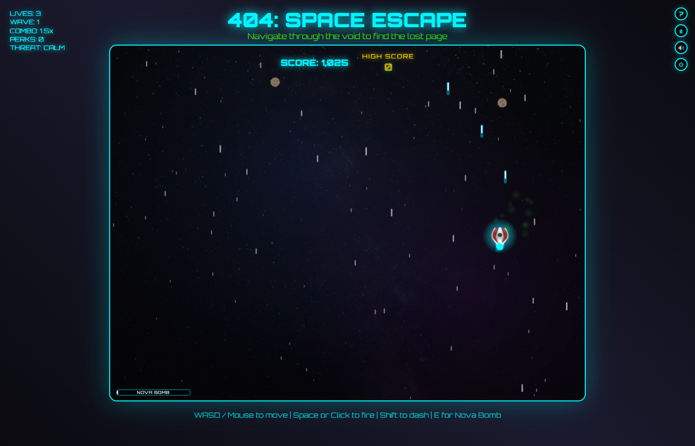

Space Escape is a wave-based browser shooter that started life as a playable 404 page. You fly a small ship through endless waves of asteroids, drones and stranger things, pick a perk after every boss, and chase a score on shared leaderboards.

It runs on plain browser modules and PHP. There is **no build step and nothing to install on the server**: upload the files as they are.

## Contents

- [What's new in 2.1](#whats-new-in-21)
- [How to play](#how-to-play)
- [Controls](#controls)
- [Enemies](#enemies)
- [Bosses](#bosses)
- [Perks, evolutions and ships](#perks-evolutions-and-ships)
- [Modes](#modes)
- [Scoring and balance](#scoring-and-balance)
- [Achievements](#achievements)
- [Settings](#settings)
- [Run it locally](#run-it-locally)
- [Deploy](#deploy)
- [Show the game on every missing page (WordPress)](#show-the-game-on-every-missing-page-wordpress)
- [How it is built](#how-it-is-built)
- [API](#api)
- [Tests](#tests)
- [Release checklist](#release-checklist)
- [Version history](#version-history)
- [License](#license)

## What's new in 2.1

- **Two new special bosses:** Moolissa the Mad Cow (wave 5) and Lilo the Red Heeler (wave 7). After wave 7 they rotate with the Boba Colossus every sixth wave.
- **Five new enemy types:** dart squadrons, flankers, snipers, mines and shield carriers.
- **Biomes:** the star colour and nebula clouds change every three waves.
- **Mouse lock:** the pointer stays inside the arena while you play. Esc releases it and pauses.
- **Balance pass:** combo, no-hit streak, rapid fire and lives are capped; bosses have more health; the DVD jackpot no longer multiplies with your combo. A good run now has to earn its score.
- **Leaderboard fix:** runs longer than 6 minutes were rejected by the server. They are accepted now. If the leaderboard can't be reached, the score is saved and sent again on the next visit.
- **Every missing page on the site shows the game** (WordPress must-use plugin in `deploy/wordpress/`).
- `SIM_VERSION` is now 3. Replays recorded with 2.0 no longer play back, because the rules changed.

## How to play

1. Clear the wave's kill quota (12 kills on wave 1, then 10 + 5 per wave). The boss arrives.
2. Beat the boss. It enrages at half health and telegraphs its heavy attacks with a dashed line.
3. Choose one of three perks.
4. Fly a short safe intermission, then the next wave starts.

**Dash** makes the ship briefly untouchable. **Grazing** (skimming past an enemy or bullet, or dashing through one) scores points and charges the **Nova Bomb**, which clears every bullet and damages everything on screen.

**Damage:** a shield charge absorbs a hit. Without one you lose a life and your most recently gained weapon upgrade, then get about a second of immunity.

**From wave 4:** elite enemies (shielded, swift, volatile, shooter) and wave mutators (Blitz, Swarm, Armored, Gold Rush, Solar Storm).

**Biomes:** every three waves the sky changes colour, so you can tell at a glance how deep you are.

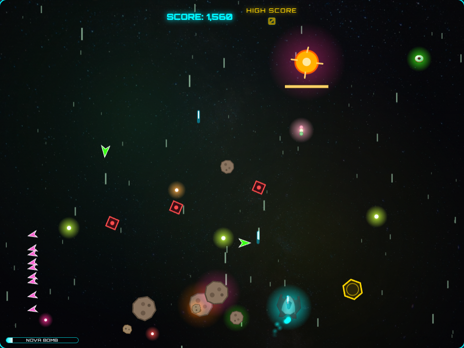

## Controls

| Action | Keyboard | Mouse | Touch | Gamepad |
| --- | --- | --- | --- | --- |
| Move | WASD / Arrows | Ship follows the pointer | Drag | Left stick / D-pad |
| Fire | Space (hold) | Left button (hold) | Automatic while touching | A / RT |
| Dash | Shift | Right click | DASH button | B / bumpers |
| Nova Bomb | E | Middle click | BOMB button | X / Y |
| Pause | P / Esc | Pause button | Pause button | Start |
| Pick a perk | 1 / 2 / 3 | Click | Tap | |

**Mouse lock.** When a run starts, the browser locks the pointer to the game and a crosshair shows where it is. The pointer cannot leave the arena. Press **Esc** to get the pointer back; that also pauses. Click the arena (or Resume) to lock it again. Menus, perk choices and the results screen release it automatically. Turn it off in Settings with "Lock mouse to the game".

Fire, dash, bomb and pause keys can be remapped in Settings.

## Enemies

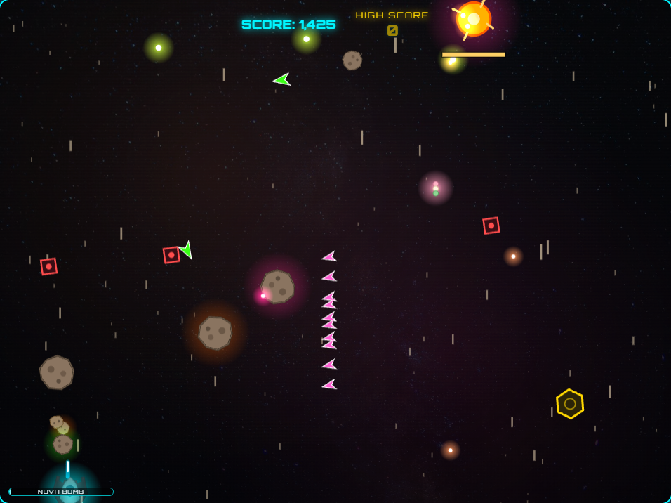

| Enemy | First wave | Looks like | What it does |
| --- | --- | --- | --- |
| Asteroid | 1 | Brown rock | Drifts towards you. Heavy ones take an extra hit and split when destroyed. |
| Fast | 3 | Small glowing orb | Quick and fragile. |
| Dart squadron | 2 | V of five pink arrows | Flies straight across the arena in formation. Get out of the lane or cut through it. |
| Sniper | 3 | Red spinning diamond | Keeps its distance, flashes white for half a second, then fires a fast red shot at you. |
| Flanker | 4 | Green arrow | Comes at you from an angle instead of head on. |
| Mine | 5 | Orange spiked star | Slow. Blows up into a ring of 8 bullets if you get close, and also when you shoot it. |
| Shield carrier | 6 | Gold hexagon | Every 3 seconds it shields the enemies around it. Kill it first. |
| Elites | 4 | Coloured aura | Shielded, swift, volatile (explodes) or shooter versions of normal enemies. |

From wave 6 there is a growing chance that two enemies spawn at once.

## Bosses

There are 20 named bosses with their own art and attack patterns, plus three special bosses on fixed waves:

| Wave | Boss | Attacks | Reward |
| --- | --- | --- | --- |
| 3 | **Boba Colossus** | Tapioca pearl volleys | Pearl celebration, 10 seconds of bonus points |
| 5 | **Moolissa the Mad Cow** | MILK SPRAY (7-shot fan), COWBELL! (14-bullet ring), STAMPEDE! (charges at you and drops calves) | MOOOOO! 10 donuts |
| 7 | **Lilo the Red Heeler** | FETCH! (three balls that bounce off the walls), WOOF! (10-bullet ring), a lunge. She circles you like she is herding sheep. | GOOD GIRL, LILO! 16 bones to collect |

After wave 7 the three special bosses take turns every sixth wave. Every boss enrages at half health, and every third boss cycle after wave 8 brings an elite version with a new title.

| Boba Colossus | Moolissa the Mad Cow | Lilo the Red Heeler |
| --- | --- | --- |
| 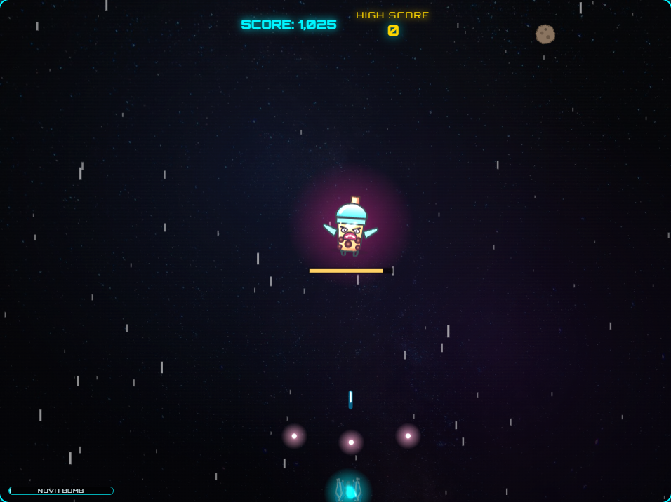 | 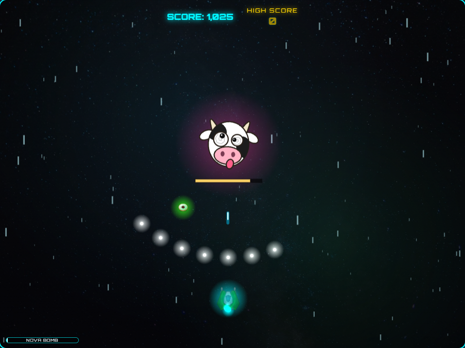 | 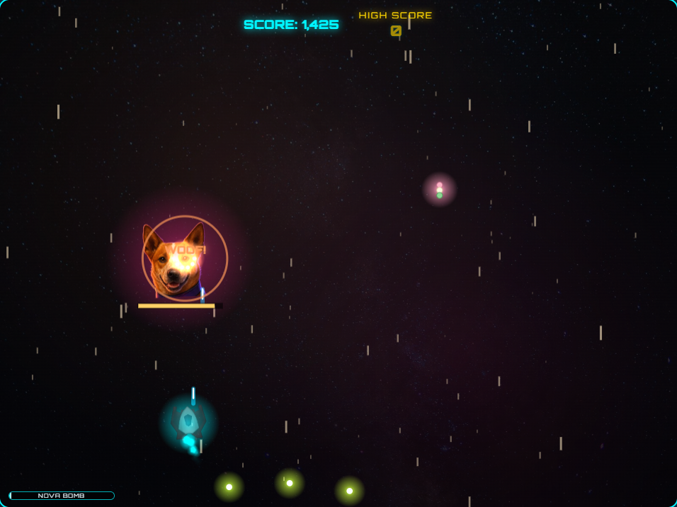 |

Moolissa is drawn live rather than from a picture, so her mismatched eyes can spin in opposite directions. When she enrages they spin faster and turn red:

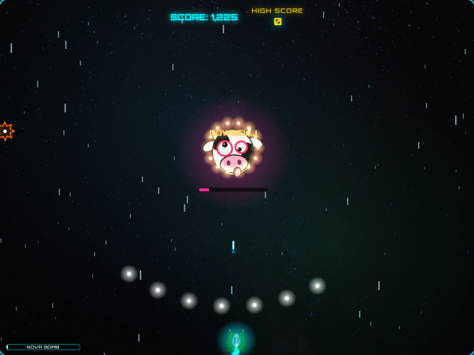

Lilo is the red heeler from [Nicholastrading.com](https://nicholastrading.com).

## Perks, evolutions and ships

After every boss you pick one of three perks. Rare perks show up less often.

| Perk | Effect | Max |
| --- | --- | --- |
| Rapid Fire | Fire faster | 8 stacks |
| Spread Fire | Adds a forward shot, up to four | 3 |
| Piercing Rounds | Shots go through an extra enemy | 3 |
| Thruster Boost | Move faster with every control scheme | 4 |
| Salvage Magnet | Pull in items from farther away | 4 |
| Reinforced Hull | Extra life now (5 lives at most) | 2 |
| Combo Mastery | Higher combo cap and longer combo window | 4 |
| Score Surge | More points for everything | 5 |
| Afterburner | Dash recharges 20% faster | 2 |
| Graze Engine | Grazes charge the bomb 40% faster | 2 |
| Auto-Fire | Fires without holding the trigger | 1 |
| Vector Thrusters (rare) | Shots fire the way you move | 1 |
| Orbital Cannon (rare) | Rotating cannon replaces your guns | stacks |
| Chain Lightning (rare) | A kill arcs to a nearby enemy | 1 |
| Homing Rounds (rare) | Shots chase the nearest enemy | 1 |

**Evolutions** switch on automatically while you hold the right perks:

| Evolution | Needs | Effect |
| --- | --- | --- |
| Storm Lance | Chain Lightning + Piercing 2 | Chain jumps to three targets |
| Swarm Missiles | Homing + Spread 2 | Harder turns, burst on impact |
| Coolant Loop | Rapid Fire 3 + Thruster 2 | No overheating |
| Jackpot Protocol | Combo 2 + Score Surge 2 | Longer combos, triple graze score |

**Ships** are picked in the Hangar:

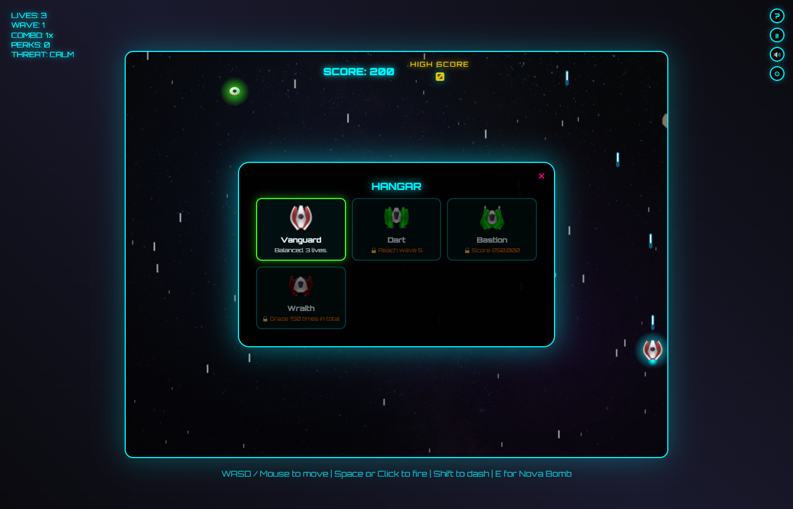

| Ship | Unlock |
| --- | --- |
| Vanguard | Start ship. Balanced, 3 lives. |
| Dart | Reach wave 5 |
| Bastion | Score 250,000 |
| Wraith | Graze 150 times in total |

## Modes

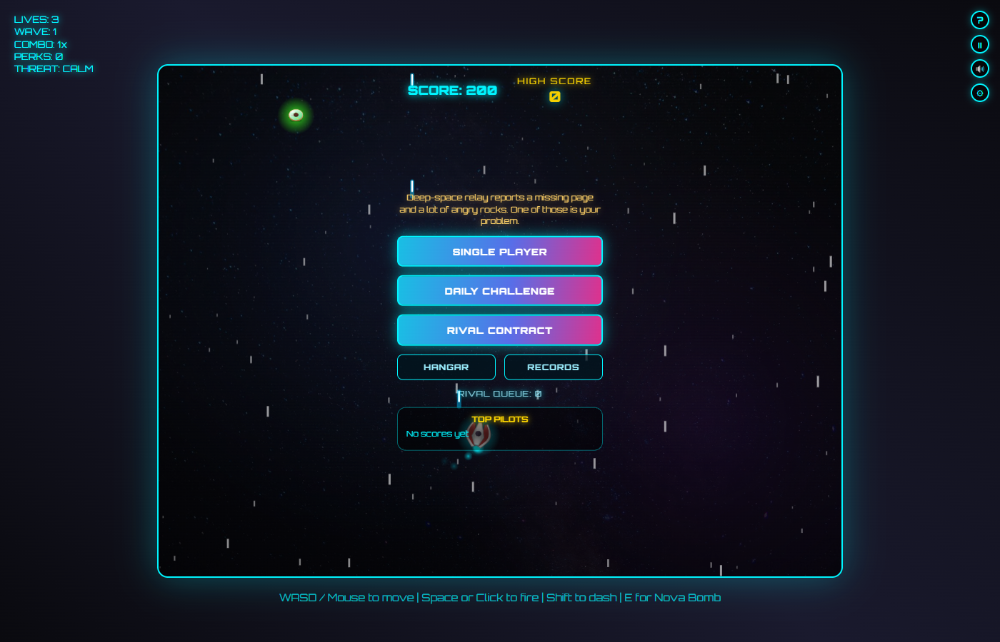

- **Single Player:** endless waves. All-Time and This Week leaderboards.
- **Daily Challenge:** one seed per UTC day, so everyone meets the same waves. It has its own board, and you race a ghost of the day's best run.
- **Rival Contract:** a three-wave score race on identical waves. Every 12 kills sends an attack squad to your rival. If nobody is waiting, you fly against the ACE bot, which plays the same seed live.
- **Records:** your best score, best wave, lifetime stats and achievements.

The menu shows the top three pilots and the Season 1 Legend (the best score from version 1).

## Scoring and balance

Points come from kills, grazes, bosses, donuts and the DVD logo, multiplied by the wave, your combo and your no-hit streak. Version 2.1 tightened the numbers after a playtest reached 3 million by wave 15:

| Rule | 2.1 value | Why |
| --- | --- | --- |
| No-hit streak multiplier | Capped at 4 | It used to climb to 12 |
| Rapid Fire stacks | Capped at 8 | Unlimited fire rate melted bosses |
| Lives | Capped at 5. Extra life pickups at the cap give 2,000 × wave multiplier points instead | Stacked lives removed all risk |
| Boss health | Base × (1.5 + 0.6 × wave) | Late bosses died in 1 to 10 seconds |
| DVD jackpot | No longer multiplied by combo | One catch was worth more than a wave |
| Difficulty director | Speeds up spawns by up to 90% while you are unhurt, backs off after a hit | Keeps strong runs under pressure |

All tuning numbers live in `TUNE` at the top of `js/data.js`.

## Achievements

| Achievement | How |
| --- | --- |
| First Blood | Defeat a boss |
| Tea Time | Splash the Boba Colossus |
| Udder Chaos | Defeat Moolissa the Mad Cow |
| Good Girl | Win a game of fetch against Lilo |
| Screensaver | Catch the DVD logo |
| The Corner | Land a perfect DVD corner catch |
| Untouchable | Clear three waves in a row without damage |
| Deep Space | Reach wave 10 |
| Six Figures / Half a Million / Legend | Score 100,000 / 500,000 / 1,000,000 |
| Evolution | Unlock a weapon evolution |
| Thread the Needle | Graze 50 times in one run |
| Clean Slate | Detonate a Nova Bomb |
| Contract Killer | Win a Rival Contract |
| Daily Driver | Finish a Daily Challenge run |

## Settings

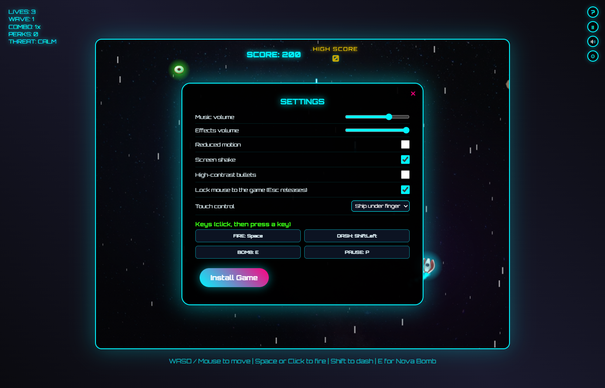

Music and effects volume, mute, reduced motion, screen shake, high-contrast bullets, mouse lock, touch scheme (direct or relative drag) and key remapping. Settings, stats and achievements are stored in the browser (`localStorage`), so they stay on that device.

The game works on phones too, and can be installed as an app from the browser menu:

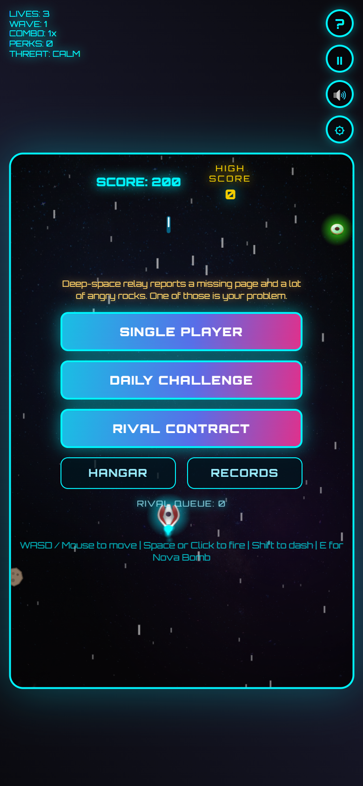

## Run it locally

```powershell
php -S localhost:8000
```

Open `http://localhost:8000/404.shtml`. PHP 8.0 or later. Opening the file straight from disk (`file://`) does not work, because browsers do not load modules that way.

On `localhost` only, `window.__game` is exposed in the browser console:

```js
window.__game.auto(true)   // the autopilot flies the run
window.__game.sim          // the live simulation (wave, score, enemies, player)
```

## Deploy

Upload this tree to the web folder that serves the game (live: `public_html/bstudio/` on the GreenGeeks cPanel account):

```text
bstudio/
|- 404.shtml              # page, styles, menus
|- manifest.webmanifest   # install metadata
|- sw.js                  # offline cache (bump CACHE in it on every release)
|- js/                    # the game modules
|- assets/                # ships, donuts, boss art, Lilo, background, icons
`- api/                   # PHP endpoints
   |- .htaccess           # blocks direct download of data files
   `- data/               # runtime data, created and filled by the API
      `- .htaccess        # denies all web access
```

1. Keep the folder names. All paths are relative to `404.shtml`.
2. `api/` and `api/data/` must be writable by PHP (`755`, or `775` if the host needs it).
3. Check that `…/api/game.php?a=home` returns JSON.
4. To make the site root's `/404.shtml` show the game too, upload `deploy/root-404.shtml` there **renamed to `404.shtml`**. It forwards to `/bstudio/404.shtml`, so there is one copy of the game and one leaderboard.
5. Do not upload `test/`, `tools/`, `deploy/`, `docs/` or `node_modules/`.
6. **Do not touch the other files in `bstudio/`** on the live server (`.git`, `config`, `modules`, `pdfs`, `web-form`, its `.htaccess`, dashboard backups). They belong to another application.

**Caching.** The host sends long cache headers on JS files. The service worker fetches with `no-cache`, so a release reaches players once `sw.js` itself is refreshed. Always bump `CACHE` in `sw.js` when you release, and after uploading, check the live files with a cache-busting query (`?v=123`).

## Show the game on every missing page (WordPress)

`texascabinetryco.com` runs WordPress, which answers missing pages with its own theme page. `deploy/wordpress/space-escape-404.php` replaces that with the game:

1. Upload it to `public_html/wp-content/mu-plugins/` (create the folder if it is missing). Must-use plugins are always on and do not appear in the Plugins list.
2. Visit any missing page, for example `/this-page-does-not-exist`. The game appears.

What it does:

- Only acts on real "page not found" responses for pages (requests that accept HTML and have no file extension). Missing images, scripts and bot probes still get the normal 404.
- Keeps the **404 status**, so search engines still see the page as missing.
- Reads `bstudio/404.shtml` and adds `<base href="/bstudio/">` so its scripts, art and API calls load from the real folder.
- If the game file is missing, it falls back to the theme's 404 page.

To undo it, delete the file.

## How it is built

| File | Role |
| --- | --- |
| `js/sim.js` | The whole game as a fixed 60-ticks-per-second simulation. No DOM, no clock, no `Math.random`. Enemies, bosses (including the cow and Lilo), scoring, the difficulty director. |
| `js/rng.js` | Seeded random numbers and deterministic trigonometry |
| `js/data.js` | Perks, evolutions, ships, mutators, achievements, tuning numbers (`TUNE`) |
| `js/bosses.js` | Boss table and inline SVG art |
| `js/bot.js` | Autopilot for attract mode and the ACE rival |
| `js/replay.js` | Input recording, playback and verification |
| `js/render.js` | Canvas renderer: sprites, hand-drawn enemies, the cow's eyes, biomes, particles |
| `js/audio.js` | Synthesized effects and scheduled, layered music |
| `js/input.js` | Keyboard, mouse (with pointer lock), touch, gamepad |
| `js/meta.js` | Local profile: settings, unlocks, achievements |
| `js/net.js`, `js/ui.js`, `js/main.js` | API calls, DOM helpers, game loop and menus |
| `sw.js` | Service worker for offline play |

Because the simulation is deterministic, the same seed and inputs always give the same run. That one property powers replays, ghosts, the bot rival and score verification. If you change game rules, bump `SIM_VERSION` in `js/sim.js` so old replays are not checked against new rules.

## API

| Endpoint | Purpose |
| --- | --- |
| `GET api/game.php?a=home` | Top 10 of each board, daily seed, lore, Season 1 champion |
| `GET api/game.php?a=board&b=all\|weekly\|daily` | Top 100 of one board |
| `GET api/game.php?a=ghost&b=daily` | Best stored replay of a board |
| `POST api/game.php {a:"start", mode}` | Signed run token and seed |
| `POST api/game.php {a:"submit", …}` | Score, stats and replay for a finished run |
| `api/duel-queue.php`, `api/duel.php` | Rival Contract queue, live progress, attacks, results |

Data is stored as JSON files in `api/data/`, written under a file lock.

### Anti-cheat

- A score needs a server-signed run token, and a token works once. Tokens last 6 hours.
- The server rejects runs that are impossible for the time elapsed (more game time than wall time, or more points than the wave and duration allow).
- Submissions and run starts are rate limited per address (addresses are stored hashed).
- Top-10 entries keep their input replay. `node tools/verify-replay.mjs <folder>` re-simulates each one and reports any whose score does not match. Run it on a copy of `api/data` when a score looks wrong.
- If a submission is refused, the game says why. If the server can't be reached, the score is kept in the browser and sent again next time.

These checks stop casual tampering. They are not proof against a determined attacker.

### AI daily lore (optional)

The mission briefing on the menu and the boss taunts can be written fresh each day by Claude. Without a key the game uses built-in lines.

1. Copy `api/config.example.php` to `api/data/config.php` on the server and add an Anthropic API key.
2. Recommended: add a daily cron job, `php /home/<account>/public_html/bstudio/api/lore.php`.

The call happens at most once a day and is cached in `api/data/`. The text is cosmetic and never affects gameplay or scores.

## Tests

```powershell
node test/sim.test.mjs      # determinism, replay round-trip, autopilot progression table
php -S localhost:8000       # in one terminal
node test/api.test.mjs      # in another: tokens, submission, anti-cheat, ghost, rival queue
```

The API test writes into `api/data/`. Clear its JSON files afterwards so test scores are never uploaded.

## Release checklist

1. Bump `GAME_VERSION` in `js/data.js` and `CACHE` in `sw.js`. Bump `SIM_VERSION` if game rules changed.
2. Run both tests.
3. Play a run locally.
4. Upload the changed files to `bstudio/` and check them live with a cache-busting query.
5. Add an entry to [Version history](#version-history), update the version and date at the top of this README, and refresh the screenshots in `docs/images/` if the look changed.

## Version history

Versions follow [Semantic Versioning](https://semver.org/):

- **MAJOR:** a rebuild or a change that breaks saved replays and leaderboards
- **MINOR:** new features (bosses, enemies, perks, modes)
- **PATCH:** bug fixes and small adjustments

The version lives in three places, kept in step on every release: `GAME_VERSION` in `js/data.js`, `CACHE` in `sw.js`, and the top of this file. `SIM_VERSION` in `js/sim.js` is separate and only goes up when game rules change.

### 2.1.0 (2026-11-25)

- New special bosses: Moolissa the Mad Cow (wave 5) and Lilo the Red Heeler (wave 7), rotating with the Boba Colossus every sixth wave after wave 7.
- New enemies: dart squadrons, snipers, flankers, mines and shield carriers.
- Biomes: the sky changes colour every three waves.
- Mouse lock: the pointer stays in the arena; Esc releases it and pauses. Can be turned off in Settings.
- Balance pass: caps on the no-hit streak (4), Rapid Fire (8) and lives (5); tougher bosses; DVD jackpot no longer multiplied by combo; Reinforced Hull limited to 2.
- Fix: the server rejected runs longer than 6 minutes. Rejected or unreachable submissions now show the reason and are retried on the next visit.
- Security: Rival Contract seats are protected by a per-player key; the shared attack count can only grow; the score plausibility bound was tightened.
- WordPress must-use plugin shows the game on every missing page of the site.
- Achievements: Udder Chaos and Good Girl.
- Simulation version 3: 2.0 replays no longer play back.
- README rewritten with screenshots.

### 2.0.x (2026-11)

2.0.1 to 2.0.4 were layout and caching fixes after launch: the arena grows to 1,400 px on large screens, the Top Pilots box moved into the menu column, the Season 1 Legend line stays on one line, and the service worker always fetches fresh files despite the host's long cache headers.

### 2.0.0 (2026-11)

The Nicholas Tech LLC edition, a full rebuild:

- Deterministic 60 Hz simulation split into modules, with a canvas renderer, particles and synthesized layered music.
- New mechanics: dash, grazing, Nova Bomb, weapon evolutions, elite enemies, wave mutators, boss enrage phases and a difficulty director.
- Ships with unlocks (Vanguard, Dart, Bastion, Wraith), achievements and a local profile.
- Daily Challenge with a ghost of the day's best run.
- Rival Contract rebuilt on a shared seed, with attack squads and the ACE bot when nobody is waiting.
- Real leaderboards (All-Time, This Week, Daily) with signed run tokens, rate limits, plausibility checks and stored replays that can be re-simulated.
- Installable, works offline, gamepad support, remappable keys and accessibility settings.
- Optional daily lore written by Claude.
- Studio credit changed to Nicholas Tech LLC. Leaderboards restarted as Season 2; the v1 champion is shown as the Season 1 Legend.

### 1.6.1 (2026-09-01)

- Mobile: touch offset reduced from 60 to 40 pixels so the ship sits closer to the finger.

### 1.6.0 (2026-08-31)

- Japanese sweets pickups: Mochi (double fire rate), Dango (double points), Sushi (big pickup radius), Taiyaki (immunity).
- Heavy asteroids that split into fragments.
- Boba Colossus 10-second celebration with collectible pearls.
- DVD corner easter egg with a perfect-catch bonus.
- Nebula background; unused junk art removed.

### 1.5.3 (2026-08-29)

- Boba Colossus updates.

### 1.5.2 (2026-08-29)

- Rival Contract: request and accept queue (`api/duel-queue.php`) and daily results (`api/duel.php`).
- Large gameplay and README update.

### 1.0.0 (2026-08-28)

- Initial release: wave-based arcade shooter on the 404 page, with perks, a shared leaderboard and attract mode.

## License

Project code is MIT licensed. Bundled and replacement artwork remains subject to its source license; Kenney assets are CC0. Lilo's portrait belongs to Nicholas Trading.
